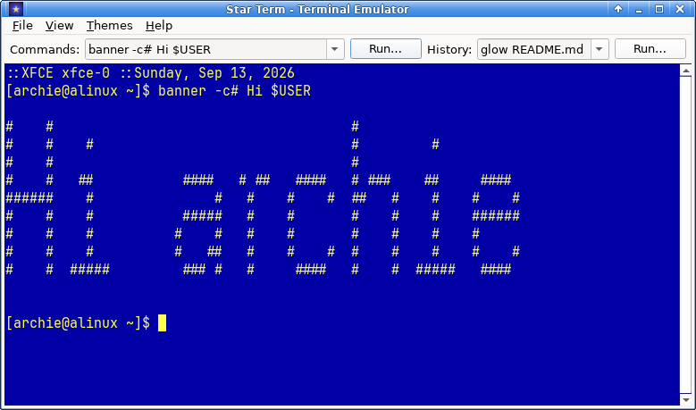
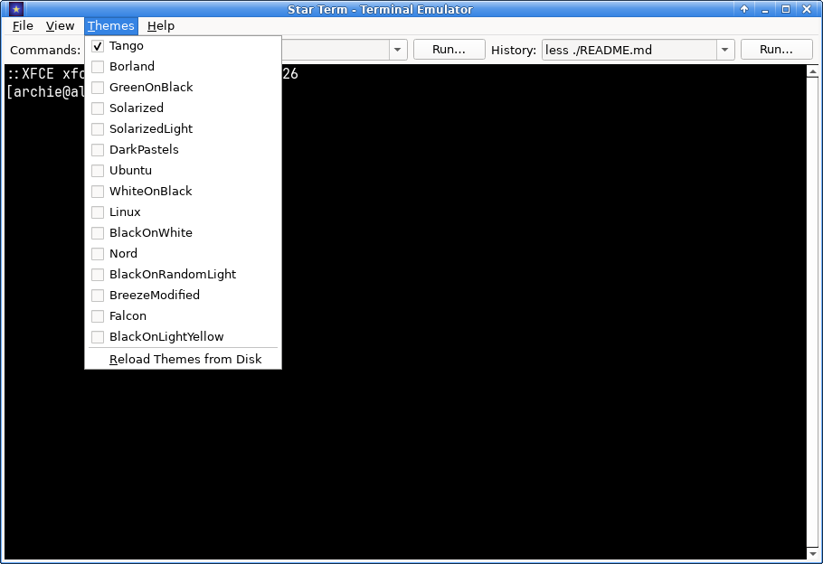

# StarTerm

**Star Term** is a lightweight, tabbed terminal emulator built with Qt 6 and
QTermWidget. It's optimised for Linux (XFCE4) and written in C++.



---

## Features

- **Multiple tabs** — closable, movable, and optionally hidden
  - *Hide Tabs* — hide the tab bar entirely for a clean single-tab view
  - *Auto Hide Tabs* — hide the tab bar automatically when only one tab exists
- **Copy & Paste** — full clipboard integration
- **Monospace-only font picker** — name, size, weight, and italic saved to your config
- **Multiple colour themes** — built-in QTermWidget themes plus any you drop
  into a `color-schemes/` folder next to the binary
- **Run Command Panel** — two dropdowns above the tabs:
  - **Commands** — a curated list loaded from `commands.txt`
  - **History** — recent entries from your shell history file
  - Each dropdown has its own **Run…** button
  - Pick an item and press **Enter** to run it; type your own and press
    **Enter** to run that too
- **Safety filter** — commands starting with `sudo`/`su`/`doas`/`pkexec` or
  containing destructive patterns (`rm -rf /`, `mkfs`, `dd if=`, etc.) are
  refused from the panel
- **Persistent preferences** — theme, font, panel visibility, tab-bar
  behaviour, and status-bar visibility are all remembered between runs
- **Keyboard shortcuts** — see the table below

Built with Qt 5/6 and QTermWidget.

---

## Screenshots



---

## Requirements

- **Linux** (developed on Arch/ALinux with XFCE4)
- **Qt 6** (`qt6-base`) or Qt 5
- **QTermWidget 6** (`qtermwidget`) or QTermWidget 5
- A C++17-capable compiler (g++ or clang++)
- `qmake` or an existing `Makefile` generated by `qmake` / `cmake`

---

## Installation

### Arch Linux

```bash
sudo pacman -Syu qtermwidget
